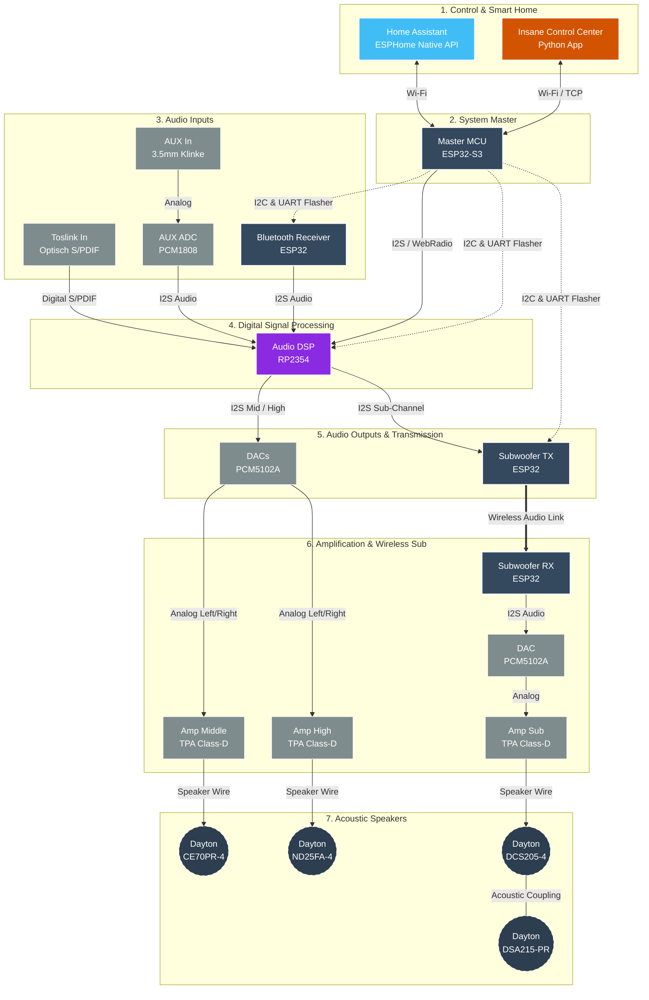
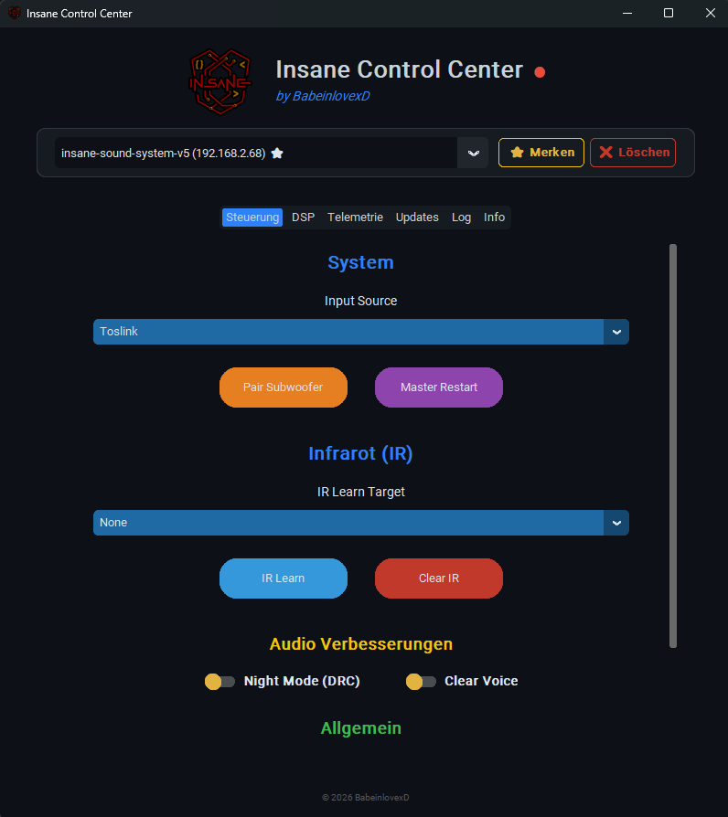
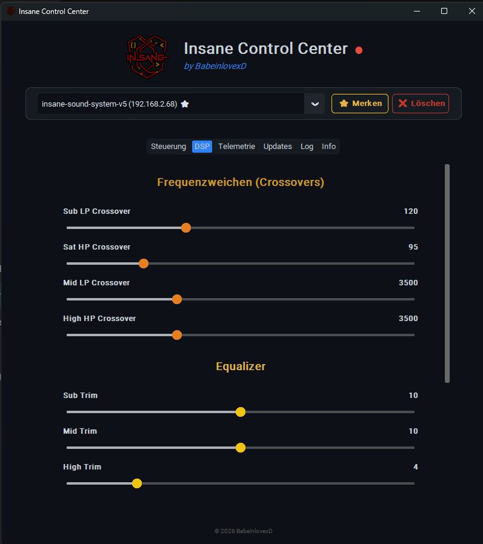
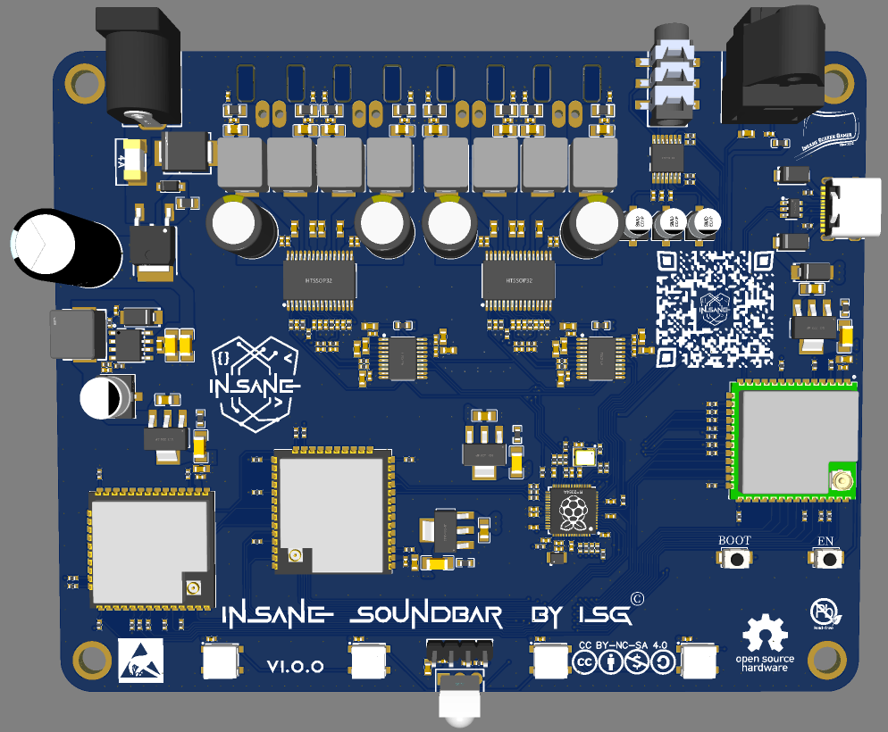
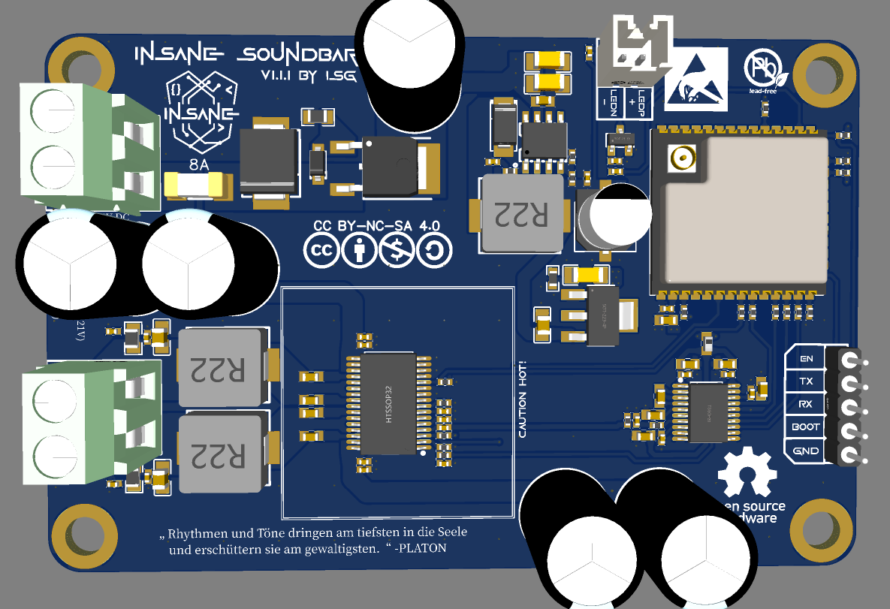

  

# Insane Soundbar

[Issues](https://github.com/babeinlovexd/Insane-Soundbar/issues) · [Releases](https://github.com/babeinlovexd/Insane-Soundbar/releases)

A **DIY soundbar project in development**, combining ESP32 controllers, an RP2354A DSP, a wireless subwoofer and ESPHome/Home Assistant integration. This hardware has not yet been tested as a complete real-world build by the author.

## Architecture

| Part | Design role |
| :--- | :--- |
| ESP32-S3 master | ESPHome, network audio, controls and orchestration |
| Bluetooth ESP32 | A2DP reception and metadata |
| RP2354A | DSP, input routing and crossover processing |
| Sub-TX / Sub-RX ESP32s | Wireless subwoofer audio link |
| Audio hardware | PCM1808 ADC, PCM5102A DACs, TPA3118D2/TPA3116D2 amplifiers |

The design includes Bluetooth, network, AUX and optical S/PDIF input paths and Dayton speaker drivers. Availability in the source tree is not a completed hardware validation or a guarantee of lossless Bluetooth transmission.

## Files & build targets

- [Firmware/Master/insane_soundbar.yaml](Firmware/Master/insane_soundbar.yaml): ESPHome master configuration.
- [components](components): ESPHome orchestration and stream-server components.
- [Firmware/DSP](Firmware/DSP): Pico SDK/CMake DSP implementation.
- [Firmware/Bluetooth](Firmware/Bluetooth): Bluetooth firmware.
- [Firmware/SUB_TX](Firmware/SUB_TX) and [Firmware/SUB_RX](Firmware/SUB_RX): subwoofer link firmware and local instructions.
- [PCB](PCB): hardware files; [Images](Images): diagrams and interface references.
- [Insane Control Center](Insane%20Control%20Center): desktop and Android sources.

The standalone `Firmware/Master/platformio.ini` is an ESP-IDF target. It does not replace building `insane_soundbar.yaml` through ESPHome.

## Setup

1. Select a matching hardware/firmware revision and review schematics and power rails before assembly.
2. Copy the ESPHome master YAML into your configuration directory. Provide your own local `secrets.yaml` containing `api_encryption_key`, `ota_password`, `wifi_ssid`, `wifi_password` and `ap_password`.
3. Review pins, board/PSRAM settings and connected modules; validate and compile the YAML with ESPHome. Initial master flashing is via USB.
4. Build each companion firmware with its own toolchain, or use the matching files from this repository's [Releases](https://github.com/babeinlovexd/Insane-Soundbar/releases).
5. Test each controller and link independently before connecting amplifiers/speakers and integrating Home Assistant.

## Downloads & Control Center

| Release file | Target |
| :--- | :--- |
| `bluetooth_firmware.bin` | Bluetooth ESP32 |
| `sub_tx_firmware.bin` | Subwoofer transmitter |
| `sub_rx_firmware.bin` | Subwoofer receiver |
| `isb_dsp.bin` / `isb_dsp.uf2` | DSP; choose the format for the actual flashing interface |
| `InsaneControlCenter.exe` | Windows desktop tool |
| `InsaneControlCenter.apk` | Android control app |

Use the release downloads, not a dummy EXE in the source tree. The desktop source [InsaneControlCenter.py](Insane%20Control%20Center/Linux/InsaneControlCenter.py) uses `customtkinter requests esptool zeroconf pillow pyserial`. Run it from its directory so its graphics remain available.

The desktop updater checks **Insane-Soundbar** releases and matches the exact binary filename for each target. A source update does not update an already downloaded executable. The Android app is a control interface; its current version intentionally does not provide firmware flashing.

## Flashing prerequisites

The desktop proxy uses port **8083** for Bluetooth and **8082** for Sub-TX. The DSP proxy sends firmware through a separate raw serial path and needs the bootloader expected by that protocol. A native RP2354 ROM is not a generic raw-UART firmware receiver; prefer the appropriate native flashing method, such as UF2 when supported by the actual board.

For local builds, use the checked-in [GitHub Actions workflows](.github/workflows) as the source of toolchain commands for each controller and application. Do not mix binaries between Soundbar, V5 and Sound System 2.1.

## Troubleshooting

- **Wrong update:** Check the Soundbar release, exact target filename and current desktop build.
- **No sound:** Trace one path at a time through input, DSP, DAC and amplifier; check clocks, mute and power first.
- **Subwoofer link:** Compare TX/RX firmware and pairing/network configuration using their individual READMEs.
- **Control app fails:** Check master IP, local network reachability and the configured HTTP API.
- **DSP transfer completes but firmware does not start:** Confirm the required bootloader and flashing format; a completed socket transfer alone is not a flash verification.

 

 

## License

The existing [LICENSE.md](LICENSE.md) distinguishes **CC BY-NC-SA 4.0 for hardware, schematics and documentation** from **MIT for software and firmware source**, including configuration files and build pipelines. Third-party components retain their respective licenses.

---

## Builds and releases

Version: **0.1.9** ([VERSION](VERSION)). [GitHub Actions](.github/workflows/release.yml) checks each push and pull request. A tag matching `v` + `VERSION` publishes a release after all jobs succeed; manual runs provide build artifacts. [Downloads](https://github.com/babeinlovexd/Insane-Soundbar/releases).

ESPHome CI uses dummy credentials and does not flash devices. Configure your own secrets and pin assignments before deployment.

## Contributing

Questions, bug reports and contributions are welcome. Include version, setup and reproduction steps in an [Issue](https://github.com/babeinlovexd/Insane-Soundbar/issues). Please discuss larger changes before a pull request.

Support this hobby project: [PayPal](https://www.paypal.me/babeinlovexd).

[BxD / BabeinlovexD](https://github.com/babeinlovexd) · [Website](https://babeinlovexd.de/)
